<div align="center">

<a href="https://viraldhoka.vercel.app">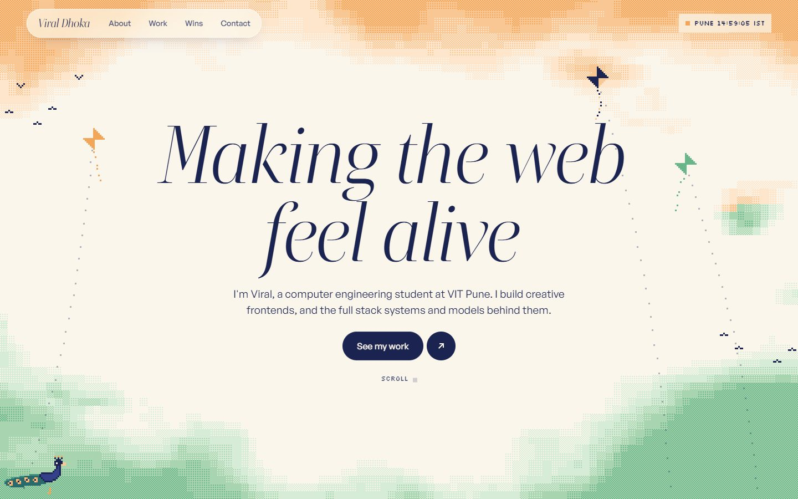</a>

<br />
<br />


# Viral Dhoka

**Making the web feel alive.**<br />
Computer engineering student at VIT Pune. Creative frontend, full stack, backend and AI.

<br />

<a href="https://viraldhoka.vercel.app"></a>
<a href="https://www.linkedin.com/in/viral-dhoka-1aa3b4318/"></a>
<a href="https://www.instagram.com/viraldrafts/"></a>
<a href="mailto:viralnotviral@gmail.com"></a>

<br />


</div>

<br />

## The idea

A pixel sky in flag order: **saffron clouds above, clear ivory between, green clouds below**, with chakra navy as the ink. Every shade is a pastel step from the real flag colours, so it reads as India without ever showing a flag.

As you scroll, the clouds close into night and a single particle system tells the story. Then the work sits on a curved shelf of tapes, each cover a real screenshot dithered into the palette.

**Mor** (मोर, peacock) is the guide. He walks along the bottom of the page as you read, turns round when you scroll back, and fans all 24 feathers if you click him. 24 echoes the spokes of the chakra, and it is also how the loader counts.

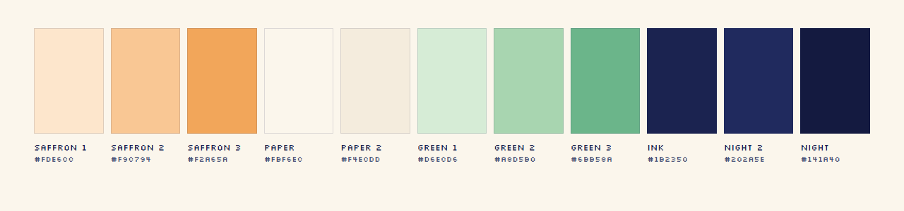

## A tour

<table>
  <tr>
    <td width="50%">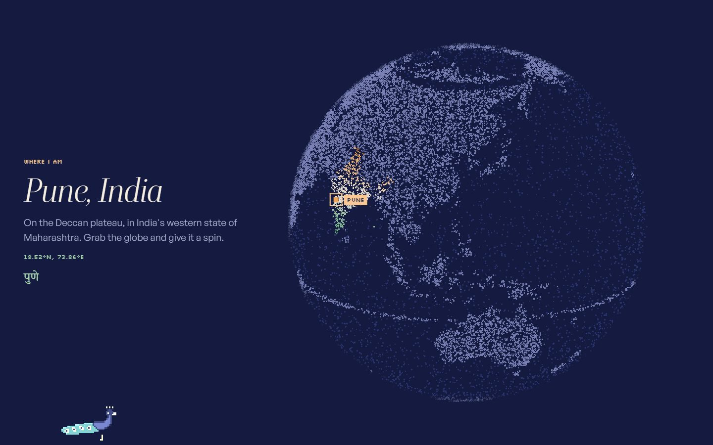</td>
    <td width="50%">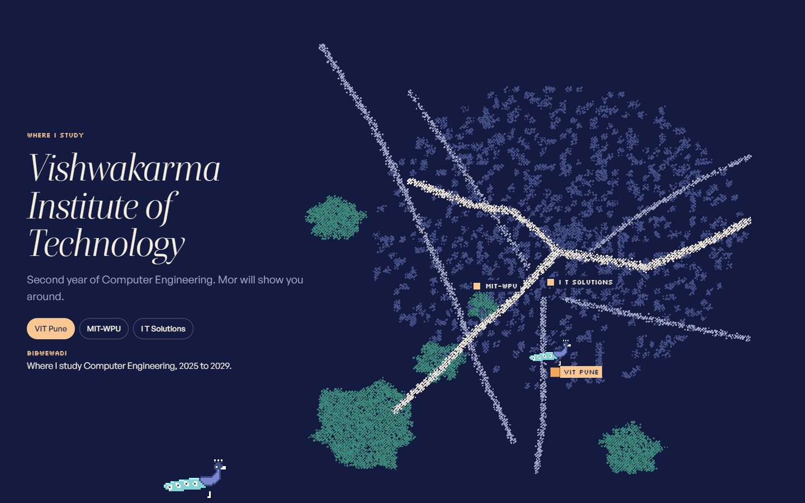</td>
  </tr>
  <tr>
    <td><b>Where I am.</b> Spin the globe. It turns itself to face Pune, then dissolves into a map of India you can hover state by state.</td>
    <td><b>Where I study.</b> Pune, drawn from real coordinates. Pick a place and Mor walks over to it.</td>
  </tr>
  <tr>
    <td>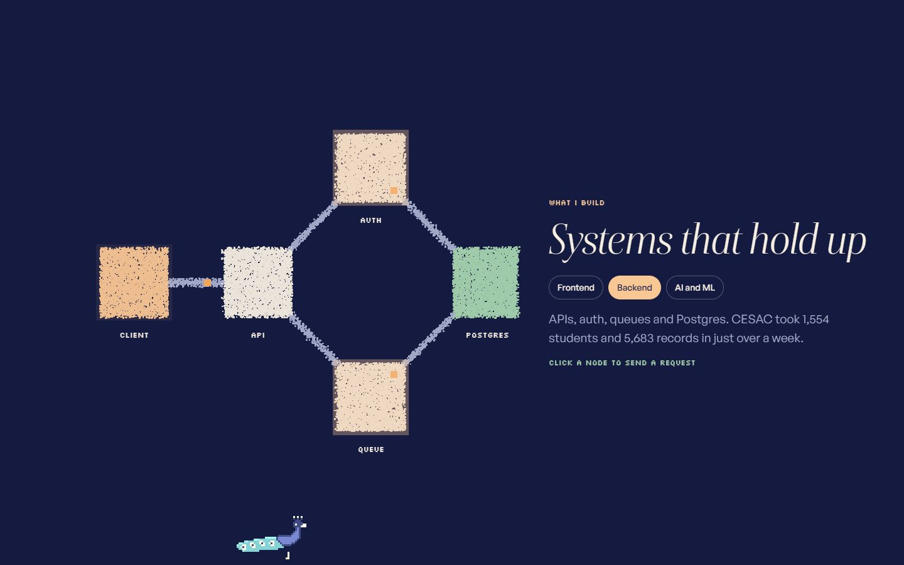</td>
    <td>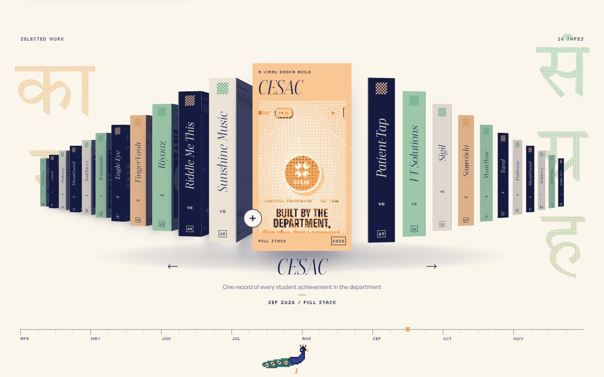</td>
  </tr>
  <tr>
    <td><b>What I build.</b> Frontend, backend and AI tabs. Click a node to send a request, or a neuron to fire it.</td>
    <td><b>The shelf.</b> Scroll, drag, use the arrow keys or click the month ruler.</td>
  </tr>
  <tr>
    <td>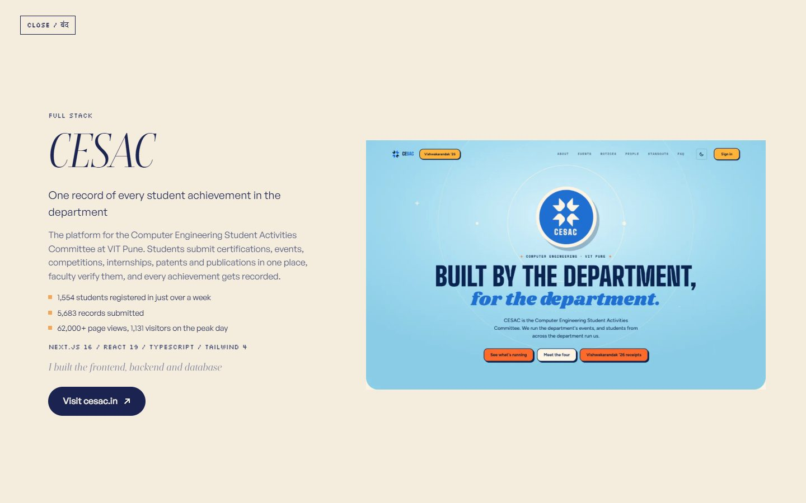</td>
    <td>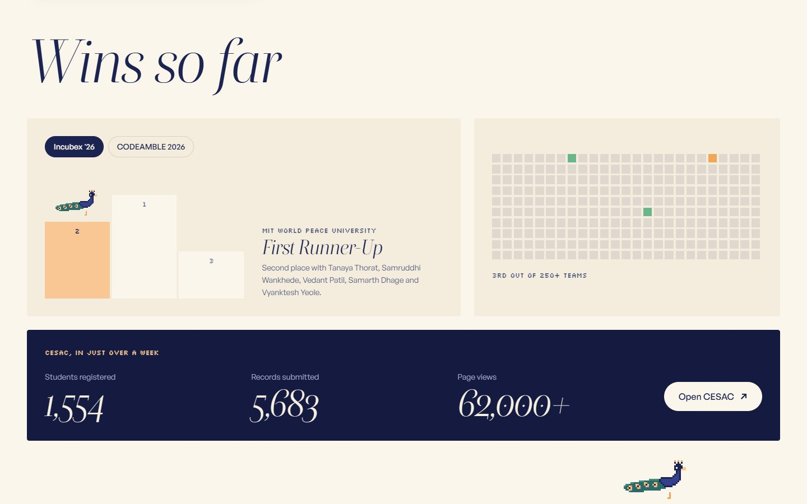</td>
  </tr>
  <tr>
    <td><b>Open a tape.</b> Paper grows out of the cover and the screenshot bleeds in like ink.</td>
    <td><b>Wins so far.</b> Mor stands on the step we finished on.</td>
  </tr>
</table>

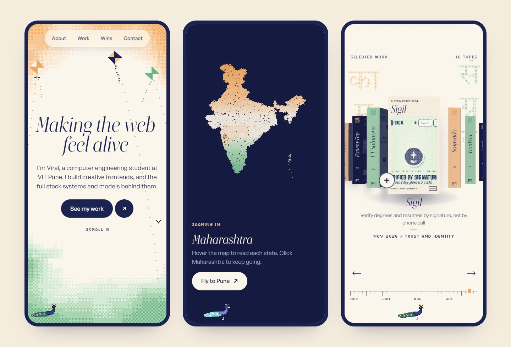

## On the shelf

Live custom domains come first.

| | Project | What it is | With |
| --- | --- | --- | --- |
| 01 | [**CESAC**](https://www.cesac.in) | One record of every student achievement in the department. 1,554 students in just over a week | Frontend, backend and database |
| 02 | [**Patient-Tap**](https://www.patient-tap.shop) | An encrypted medical ID on your wrist. Second Runner-Up, CODEAMBLE 2026 | Team Vishwakarma gng |
| 03 | [**I T Solutions**](https://itspune.in) | Website and repair tracker for a Pune service shop | Client build |
| 04 | [**Sigil**](https://www.sigil-vk.online) | Verify degrees and resumes by signature, not by phone call | Team Sigil, VIT Pune |
| 05 | [**Saṃvāda**](https://samvada-ten.vercel.app) | Learn a language by speaking it, in ten languages | Solo |
| 06 | [**WattWay**](https://wattway-nu.vercel.app) | EV charging that picks the best charger, not the closest | Team Kothimbir |
| 07 | [**Taral**](https://taral-beta.vercel.app) | CAPTCHA reimagined as a narrated fairytale | Pixathon by Insight AI |
| 08 | [**Pathway**](https://pathway-credit-recourse.vercel.app) | A loan rejection turned into a roadmap | Hackathon prototype |
| 09 | [**AbyssGuard**](https://abyssguard.vercel.app) | Marine debris from side-scan sonar | Team TMS<3, SIH 2026 |
| 10 | [**SatQuery**](https://satquery-delta.vercel.app) | Ask Earth a question, get intelligence | Team TMS<3, SIH 2026 |
| 11 | [**Immunis**](https://immunis.vercel.app) | An adversarial immune system for payment networks | Python engine and web |
| 12 | [**Eagle Eye**](https://eagle-eye-qc.vercel.app) | AI quality control for electrical cabinets | Team Vishwakarma gng |
| 13 | [**FingerVault**](https://fingervault.vercel.app) | Privacy-first biometric records | Group 17, Dr. Rahul Diwate |
| 14 | [**Riyaaz**](https://riyaaz-three.vercel.app) | A practice room for Hindustani classical vocal | PWA and Android |
| 15 | [**Riddle Me This**](https://repotemp-taupe.vercel.app) | A riddle game with NLP answer matching | Solo |
| 16 | [**Sunshine Music**](https://sunshinemusic.vercel.app) | A hand-tracked instrument in the browser | Solo |

## Type

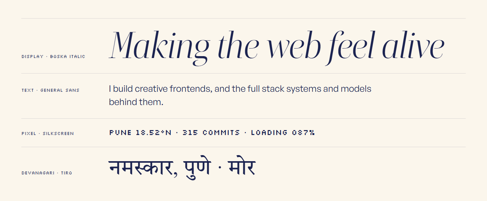

## How it is built

Vite, React and TypeScript, with GSAP and Lenis for motion and **hand-written WebGL** for the sky and particles. No UI framework and no Three.js, so the whole site is about 220 KB gzipped.

| Piece | What it does | File |
| --- | --- | --- |
| Sky | Dithered pixel clouds at half resolution that billow, part around the pointer and close into night | [`Sky.tsx`](src/gl/Sky.tsx) |
| Sky life | Pixel birds that scatter from the pointer, kites that lean toward it | [`SkyLife.tsx`](src/gl/SkyLife.tsx) |
| Particles | 34,000 pixels (16,000 on phones), one buffer per shape, a shock ring on click | [`Particles.tsx`](src/gl/Particles.tsx) |
| Story | Globe, India, Pune, the build tabs and the sunrise, all on one sticky stage | [`Story.tsx`](src/components/Story.tsx) |
| Shelf | Tapes on a curved arc that recedes into depth, driven by scroll | [`Shelf.tsx`](src/components/Shelf.tsx) |
| Detail | Paper that grows out of a cover, with the screenshot bleeding in as ink | [`Detail.tsx`](src/components/Detail.tsx) |
| Loader | 24 feathers that open as the fonts arrive, greeting in Marathi, Hindi and English | [`Loader.tsx`](src/components/Loader.tsx) |
| Cursor | A square on the pointer, a short dither trail, a reticle on anything clickable | [`Cursor.tsx`](src/components/Cursor.tsx) |
| Mor | Walks, talks, and fans his tail | [`Mor.tsx`](src/components/Mor.tsx) |

Motion respects `prefers-reduced-motion`: the loader, smooth scroll, custom cursor and idle animation all switch off. The full design system lives in [`DESIGN.md`](DESIGN.md).

<details>
<summary><b>Where everything lives</b></summary>

<br />

```text
src/
  data/site.ts          projects, wins, research, pins, links and contact
  data/commits.ts       commit calendar snapshot
  data/land.ts          one-degree land mask for the globe
  gl/                   Sky, SkyLife, Particles
  components/           Story, Shelf, Detail, Wins, Mor, Loader, Cursor, PixelWipe, Chrome
  lib/shapes.ts         particle shapes: globe, India, Pune, graphs, peacock fan
  lib/motion.ts         GSAP, Lenis, palette and the ready signal
  styles/tokens.css     every colour, size, ease and layer
public/
  work/<id>.webp        1280 by 800 screenshot for the detail sheet
  work/<id>-cover.png   150 by 170 dithered cover for the tape
  fonts/                self-hosted Boska, Gambetta and General Sans
```

</details>

## Run it

```bash
npm install
npm run dev
```

```bash
npm run build
```

## Add a project

1. Add an entry to `PROJECTS` in [`src/data/site.ts`](src/data/site.ts). Custom domains go first.
2. Drop a 1280 by 800 screenshot at `public/work/<id>.webp` and a 150 by 170 dithered cover at `public/work/<id>-cover.png`.
3. Push to `main`.

## Deploy

This repository is connected to the `viraldhoka` project on Vercel. Every push to `main` deploys to [viraldhoka.vercel.app](https://viraldhoka.vercel.app), and every other branch gets its own preview link.

`VITE_SITE_URL` in `.env` is the live address, used by the canonical and social tags. Change it if the site moves to a custom domain.

## Credits

- **Inspiration:** [andreas.vision](https://andreas.vision) for the pixel sky and [ingrassiadaniel.it](https://ingrassiadaniel.it) for the particle story, both Awwwards nominees.
- **Fonts:** Boska, Gambetta and General Sans by the Indian Type Foundry, from [Fontshare](https://www.fontshare.com) under the ITF Free Font License. [Silkscreen](https://fonts.google.com/specimen/Silkscreen) by Jason Kottke and [Tiro Devanagari Marathi](https://fonts.google.com/specimen/Tiro+Devanagari+Marathi) by Tiro Typeworks, both under the SIL Open Font License.
- **Maps:** India from [svg-maps](https://github.com/VictorCazanave/svg-maps) by Victor Cazanave, CC BY 4.0. Coastlines for the globe from [Natural Earth](https://www.naturalearthdata.com), public domain, via world-atlas.
- **Motion:** [GSAP](https://gsap.com) and [Lenis](https://lenis.darkroom.engineering).

<br />

<div align="center">


<sub>Made in Pune, पुणे. Say hello at <a href="mailto:viralnotviral@gmail.com">viralnotviral@gmail.com</a>.</sub>

</div>
